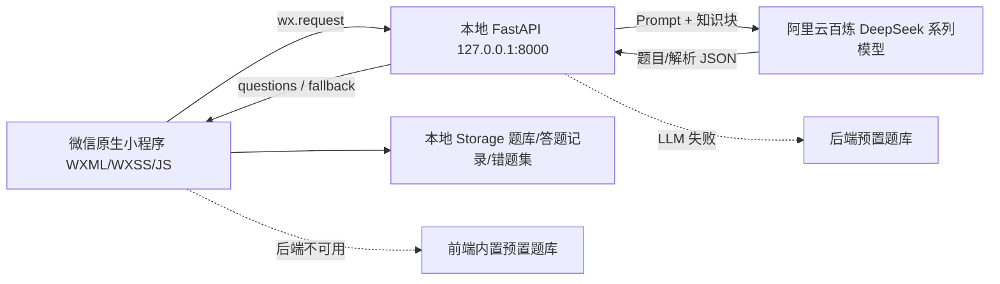

# 刷题软件知识块生成器——项目说明

> 团队：乘微逐光队（封、何、刘）  
> 比赛：第四届计算机科学与技术学部小程序设计大赛  
> 周期：2026 年 10 月 27 日—11 月 5 日开发与提交，11 月 6 日答辩  
> 形态：微信原生小程序（PC 端与手机端可用）  
> 技术：原生小程序 JS/WXML/WXSS/JSON + FastAPI + 阿里云百炼 DeepSeek 系列模型（具体模型名与模型 ID 以控制台实际显示为准）

## 1. 项目背景与问题

职业应试和考证用户面对的共同问题是：资料长、看书时间少、题库构建难。直接用 LLM 解析文档再出题，解析质量和出题稳定性都不可控。本项目把问题拆开：**用预置知识块隔离解析不确定性，把 AI 能力聚焦到可被评价的“出题质量”和“解析可追溯性”上**，形成稳定可演示的练习闭环。

核心问题：
- 资料长、上下文有限，整篇解析不稳定；
- 题库构建成本高，用户自己录题更不现实；
- AI 直接出题容易超纲、重复、解析无依据。

价值主张：把资料变成可刷、可复习、可追踪的练习系统。

## 2. 目标用户与场景

- 目标用户：考证用户、职业考试学习者、辅导老师。
- 高频场景：职业资格考试、考证刷题、章节复习。
- 用户画像：时间有限，需要把厚资料快速变成练习题。
- 核心动机：从“看资料”转为“有针对性练习”。

终端边界：

| 终端 | 适配度 | 说明 | 阶段 |
|---|---|---|---|
| PC 微信开发者工具 | 高 | 答辩演示主环境，宽屏布局 | P0 |
| 手机微信 | 高 | 可用，已完成布局与核心交互验证；答辩不作为主演示 | P0 可用 |
| 平板/Mac 阅读 | 低 | 不做 | 后续 |
| 独立 Web 端 | 不做 | 已删除 | 不做 |

## 3. 方案与 MVP 闭环

MVP 闭环：**选择预置资料 → 展示知识块 → LLM 出题 → 逐题作答 → 对错反馈与解析 → 本地记录**。

关键设计：
- 预置 2～3 套演示资料，每套人工整理 8～15 个知识块；
- 每个知识块含 `id`、`name`、`summary`、`source_excerpt`、`scope`；
- LLM 按知识块轮转出题，每套 15～20 道（单选 12～15、填空 3～5）；
- 解析强制引用 `source_excerpt`，保证可追溯；
- 双层兜底：后端 LLM 失败→后端预置题库；后端服务不可用→前端内置预置题库。

## 4. 产品形态与边界

产品形态：**微信原生小程序**，删除 Web 端和 web-view 壳。  
答辩现场：**只用 PC 微信开发者工具演示**；手机微信可用，但不作为现场主演示。  
开发要求：何使用 `rpx` 配合宽屏布局（左右分栏）、鼠标点击热区、长文本滚动区域，并在开发者工具中模拟 PC 宽屏和手机尺寸；刘第 8 天重点检查 PC 端交互无死链、无样式错乱。

明确不做：闪卡、多端同步、账号登录、云数据库、扫描件 OCR、表格/图片解析、复杂知识图谱、章节地图、多用户分享排行榜、趋势图。

## 5. 功能清单

### 5.1 P0（不做则演示不成立）

| 模块 | 具体功能 | 验收标准 |
|---|---|---|
| 入口与资料 | 预置 2～3 套演示资料选择 | 能选资料并进入生成流程 |
| 知识块展示 | 8～15 个知识块（名称+摘要+原文摘录） | 列表可读，知识块与题目正确关联 |
| LLM 出题 | 单选+填空，含题干、选项/填空、答案、解析 | 每套 15～20 题，JSON 结构稳定 |
| 练习作答 | 逐题作答，提交即时判定 | 答对显示正确，答错显示错误 |
| 反馈展示 | 正确答案+解析，解析引用原文摘录 | 可见、可读、可追溯 |
| 本地存储 | `wx.setStorageSync` / `wx.getStorageSync` | 重进不丢 |
| 预置兜底 | 后端失败→后端预置；服务不可用→前端内置 | 演示不中断；前端收到 `fallback: true` 或 `fail` 时用 `wx.showToast({title:'已切换预置题库', icon:'none'})` 提示，不阻断答题 |

### 5.2 P1（按余量取舍）

| 模块 | 具体功能 | 取舍原则 |
|---|---|---|
| 错题本 | 答错自动归集，可重练原题；答对移出保留历史 | 第 8 天核心稳定则做 |
| 本次正确率 | 结束显示得分和正确率 | 必做，成本低 |
| 累计正确率 | 多次练习正确率本地记录，数字展示 | 不做图表 |
| 掌握度简版 | 按知识块聚合正确率，<60% 标薄弱 | 静态聚合 |
| 小样本粘贴提取 | 粘贴 500～1000 字 TXT，`/extract` 只展示知识块 | 不进入出题 |

### 5.3 明确不做

闪卡；多端同步、账号、云数据库；扫描件 OCR、表格/图片解析；复杂知识图谱、章节地图；多用户、分享、排行榜；趋势图。

## 6. 技术架构

### 6.1 架构图



文字说明：小程序页面通过 `wx.request` 请求本地 FastAPI；后端组装 Prompt 调用百炼 DeepSeek 系列模型，解析 JSON 后返回；小程序把题库、答题记录、错题集写入本地 Storage。LLM 失败时后端返回预置题库并标记 `fallback: true`；后端服务不可用时前端自动切换内置预置题库。

### 6.2 技术选型

| 层面 | 选型 | 说明 |
|---|---|---|
| 前端 | 微信原生小程序，JS 非 TypeScript | 原生组件，不引第三方组件库 |
| 页面 | 普通页面跳转，不做 tabBar | 练习页即时反馈+结果页汇总 |
| 后端 | FastAPI，本地 `127.0.0.1:8000` | 客户端超时 30 秒；后端 LLM 单次超时 10 秒，重试 1 次总耗时不超过 20 秒 |
| LLM | 阿里云百炼 DeepSeek 系列模型 | 具体模型名与模型 ID 以控制台实际显示为准，通过环境变量 `DEEPSEEK_MODEL_ID` 配置 |
| 存储 | 小程序本地 Storage | 不做账号/云同步 |
| 部署 | 本地服务+开发者工具 | 勾选“不校验合法域名”；上线需 HTTPS |
| 演示 | PC 微信开发者工具 | 手机微信可用，不作主演示 |

### 6.3 接口契约

`POST /generate`

请求：
```json
{
  "knowledge_blocks": [
    {
      "id": "kp_001",
      "name": "知识块名称",
      "summary": "摘要",
      "source_excerpt": "原文摘录",
      "scope": "包含什么、不包含什么"
    }
  ],
  "question_types": ["single", "blank"],
  "count": 15,
  "existing_stems": ["已生成题干摘要"]
}
```

响应：
```json
{
  "fallback": false,
  "questions": [
    {
      "id": "q_001",
      "type": "single",
      "stem": "题干",
      "options": ["A. ...", "B. ...", "C. ...", "D. ..."],
      "answer": "A",
      "explanation": "引用 source_excerpt 的解析",
      "knowledge_point_id": "kp_001",
      "source_excerpt": "原文摘录",
      "cognitive_level": "理解",
      "steps": 1,
      "difficulty": "简单"
    }
  ]
}
```

`POST /extract`（P1）

请求：`{"text": "500～1000 字 TXT 文本"}`  
响应：`{"knowledge_blocks": [...]}`

代码实现以正式《API 接口文档.md》第 4 节 Pydantic 模型为准；早期操作手册中的 `models.py` 示例作废。

### 6.4 本地存储结构

```json
// 题库
{
  "paperId": "paper_001",
  "title": "演示资料1",
  "createdAt": "2026-10-27T10:00:00+08:00",
  "fallback": false,
  "questions": []
}

// 答题记录
{
  "recordId": "record_001",
  "paperId": "paper_001",
  "answers": [
    {"questionId": "q_001", "userAnswer": "A", "correct": true, "timestamp": "..."}
  ],
  "correctCount": 10,
  "totalCount": 15
}

// 错题集
{
  "questionId": "q_001",
  "paperId": "paper_001",
  "wrongCount": 2,
  "lastWrongAt": "...",
  "mastered": false
}
```

### 6.5 兜底与安全

- 后端 LLM 单次调用超时 10 秒，失败自动重试 1 次，总耗时不超过 20 秒；客户端 30 秒超时留 10 秒余量。
- 后端 LLM 超时或 JSON 解析失败：重试 1 次；仍失败返回后端预置题库，`fallback: true`，响应可带可选 `error` 字段，前端可只判断 `fallback`。
- 后端本地服务不可用：前端自动切换内置预置题库，并提示“已切换预置题库”。
- 每套演示资料对应一份后端预置题库和一份前端内置预置题库，切换时体验连贯，不会出现“选了资料 A 却返回资料 B 的题”。
- API Key 仅放后端环境变量，不写前端、不提交仓库；知识块与原文摘录会发送至后端/LLM 用于出题；题库、答题记录、错题集存本地；不做账号/云同步；演示电脑 Key 不随提交包提交。

## 7. AI 出题设计与质量控制

### 7.1 调用点

| 优先级 | 调用点 | 输入 | 输出 | 作用 |
|---|---|---|---|---|
| P0 | 题目生成 | 知识块+原文+题型+已生成摘要 | 单选/填空 JSON | 核心展示 |
| P0 | 解析生成 | 题目+答案+原文 | 引用原文解析 | 可追溯 |
| P1 | 质量校验/去重 | 一批题目 | 标记超纲/歧义/重复 | 质量控制 |
| P1 | 小样本知识提取 | TXT 500～1000 字 | 知识块 JSON | 自动提取展示 |

### 7.2 生成约束

- 每个知识块带唯一 ID 和范围说明（包含什么、不包含什么）；
- 出题 Prompt 明确指定知识块 ID、题型、目标难度；
- 把该知识块已生成题干摘要列给模型，要求不得与已有题目考查角度重复；
- 批量生成按知识块轮转，保证覆盖均匀。

### 7.3 轻量去重（P1）

- 字面快筛：题干归一化（去标点、去空白、数字占位统一）后比对，高度相似直接剔除；
- 同知识块内语义比对：简单文本相似度或 Embedding 余弦相似度，阈值约 0.85，超出判重复；
- 不做跨知识块全量两两计算。

### 7.4 难度分级

模型生成时提供“认知层级”和“步骤数”；后端按规则映射：记忆/理解=简单，应用/分析=中等；1 步=简单，2～3 步=中等。不依赖模型自标难度。

### 7.5 解析可追溯

每题 `explanation` 必须引用知识块 `source_excerpt` 中的原文片段。答辩强调：解析不是模型“编”的，而是有原文依据。

### 7.6 验收指标

- 每套资料 8～15 个知识块、生成 15～20 道题；
- 生成 5 道至少 3 道可用；可用标准：答案正确、干扰项合理、解析引用原文、不超纲；
- 第 6 天 2 套资料各跑 2 次，记录成功率和 Token 消耗。

## 8. 团队分工与排期

### 8.1 分工

| 成员 | 角色 | 职责 | 关键交付物 |
|---|---|---|---|
| 封 | 队长/后端+AI，技术页讲解与技术问答 | FastAPI、`/generate`、`/extract`、Prompt、百炼调用、JSON 校验重试、预置兜底、接口契约、Token 记录、联调组织、技术页讲解与技术问答 | 接口、Prompt、兜底策略、架构与接口说明、Token 预算 |
| 何 | 前端/小程序，现场操作 | 原生小程序开发、页面交互、本地存储、练习判定、错题本、正确率/掌握度、PC 适配、联调、现场操作 | 首页、知识块页、练习页、结果页、错题本、统计页、前端内置题库 |
| 刘 | PPT/资料+测试+答辩主讲 | 资料清洗、知识块整理、人工标注样卷、测试用例、全链路测试、PC/手机交叉测试、PPT、讲稿、答辩主讲 | 演示资料、知识块 JSON、样卷、测试清单、PPT、讲稿 |

协作：封维护接口契约并变更通知；每日简短同步；封记录 Token 并在百炼控制台设提醒；第 5 天全员联调并决定兜底切换；第 9 天代码封版；刘负责 PC 端兼容测试并提给何修复。

### 8.2 10 天排期

| 日期 | 封 | 何 | 刘 | 里程碑 |
|---|---|---|---|---|
| 10.27 第1天 | `/generate` 契约；FastAPI 假题目；确认调试方式 | 初始化小程序；本地存储结构；假数据闭环 | 确定 2 份资料并清洗；开始资料1知识块 | 小程序内假数据闭环 |
| 10.28 第2天 | 出题 Prompt；超时与 JSON 失败处理 | 练习页真实交互 | 完成资料1知识块；开始资料2 | 结构化题目；练习可用 |
| 10.29 第3天 | 解析 Prompt；校验+去重；“5 道 3 道可用” | 错题记录逻辑 | 逐题判断可用性；资料2知识块 | 确认可用 Prompt |
| 10.30 第4天 | 真实 `/generate`；后端兜底；试 `/extract` | 对接真实接口；加载/错误/兜底切换 | PPT 技术应用初稿；契约问题 | 小程序端完整走通 |
| 10.31 第5天 | 组织联调；降格式错误；纯预置切换 | 修 UI；本次正确率 | 演示流程与备用方案 | 全链路可演示；兜底可用 |
| 11.1 第6天 | Prompt 微调；2 套各跑 2 次记录成功率/Token | 错题本；累计正确率 | PPT 文字；边界测试 | P0 稳定；P1 可演示 |
| 11.2 第7天 | 固化演示数据；Token 余量 | 掌握度简版 | 关键界面图；手机真机截图 | 功能冻结；手机真机截图留存 |
| 11.3 第8天 | 按答辩流程操作 3 遍修 bug | 同左 | PPT 定稿；第一轮排练 | PPT 可提交；计时达标 |
| 11.4 第9天 | 代码封版；答辩环境 | 同左 | 第二轮排练；发提交包 | 提交包发出 |
| 11.5 第10天 | 确认服务/Key/网络/预置数据 | 确认环境 | 第三轮脱稿排练 | 只确认和排练 |

## 9. 测试与验收

测试用例清单（刘维护）：

| 用例 | 操作 | 预期 |
|---|---|---|
| 正常生成 | 选预置资料→生成 | 返回 15～20 题，结构完整 |
| LLM 超时 | 模拟超时 | 重试 1 次；仍失败返回后端预置，提示切换 |
| JSON 格式错误 | 模拟非法 JSON | 重试 1 次；仍失败 fallback |
| 后端未启动 | 关闭 FastAPI | 前端切内置题库，提示“已切换预置题库” |
| 答错反馈 | 答错一题 | 显示错误、正确答案、解析 |
| 答对反馈 | 答对一题 | 显示正确，解析可折叠 |
| 填空判定 | 前后空格/大小写不同 | 按去空格、忽略大小写精确匹配；不做同义词/模糊匹配 |
| 错题本 | 答错后进错题本，重练答对 | 移出错题本，保留历史，计入累计 |
| PC 宽屏 | 开发者工具 PC 尺寸 | 无死链、无样式错乱 |
| 手机尺寸 | 模拟手机尺寸 | 布局可用，按钮可点 |
| 手机真机打开 | 手机微信真机，同一 Wi-Fi，后端用电脑局域网 IP | 能进入首页、选资料、答一题、看解析；截图留存 |
| 小样本粘贴 | 粘贴 500～1000 字 | 只展示知识块，不进入出题 |
| 刷新重进 | 退出再进 | 题库、答题记录不丢 |

验收指标：每套 8～15 知识块、15～20 题；5 道至少 3 道可用；第 6 天 2 套各跑 2 次记录成功率和 Token。

## 10. 风险与应对

| 风险 | 影响 | 应对 |
|---|---|---|
| LLM 超时/格式错误 | 演示中断 | 重试→后端预置→前端内置；提示切换 |
| 本地 FastAPI 未启动 | 请求失败 | 答辩前检查；前端内置题库；提前到场启动服务 |
| API Key/余额异常 | 无法生成 | 提前检查；预置兜底 |
| PC 端样式错乱/死链 | 演示效果差 | 何双尺寸预览；刘第 8 天交叉测试 |
| 现场网络不稳 | 无法调用 | 本地服务+双层预置题库+提前到场检查（不做视频备份） |
| 时间不足 | P1 缺失 | P0 优先；第 8 天冻结功能 |

## 11. 答辩 PPT 结构（8 分钟介绍 + 2 分钟问答）

| 页码 | 内容 | 负责人 | 讲解人 | 操作/支持 |
|---|---|---|---|---|
| 1 | 封面 | 刘 | 刘 | — |
| 2 | 问题 | 刘 | 刘 | — |
| 3 | 方案 | 刘 | 刘 | — |
| 4 | 演示流程预告 | 刘 | 刘 | 何操作 |
| 5 | 技术架构 | 刘 | 封 | — |
| 6 | AI 出题设计 | 刘 | 封 | — |
| 7 | 功能对照 | 刘 | 刘 | — |
| 8 | 出题质量展示 | 刘 | 刘 | — |
| 9 | 边界与风险 | 刘 | 封 | — |
| 10 | 创新点总结 | 刘 | 刘 | — |
| 11 | 后续迭代 | 刘 | 刘 | — |
| 12 | 结尾致谢 | 刘 | 刘 | — |

主讲人为刘，负责整体串场及第 1～4、7～8、10～12 页；封负责第 5～6 页技术讲解、第 9 页边界风险讲解及技术问答；何负责现场操作演示。上表为完整版约 9 分钟，正式排练按 8 分钟控制，优先压缩第 7、11 页，保住第 4 页演示和第 6 页 AI 设计。

## 12. 交付物与提交包

| 交付物 | 负责人 | 截止 | 说明 |
|---|---|---|---|
| PPT | 刘 | 11.3 定稿 | 12 页 8+2 |
| 项目说明 Markdown | 封/刘 | 11.4 | 本文件 |
| 项目计划 docx | 封 | 11.4 | 计划与分工 |
| 源代码/预置题库/演示资料 | 团队留存 | — | 按比赛要求决定是否另交，不放入 zip |
| 提交包 zip | 刘 | 11.4 发出 | 仅 PPT+Markdown+docx |

提交包命名：`乘微逐光队+刷题软件知识块生成器.zip`。

> 免责声明：AI 生成题目仅供练习参考，题目正确性与考试范围需人工校验。

## 附录 A 术语表

| 术语 | 说明 |
|---|---|
| 知识块 | 从资料中整理出的最小可出题单元，含名称、摘要、原文摘录、范围 |
| 题块 | 由知识块生成的一组题目，当前以单题 JSON 表示 |
| source_excerpt | 知识块对应原文摘录，解析必须引用 |
| fallback | LLM 失败时切换到预置题库的标记 |
| 掌握度 | 按知识块聚合的正确率，低于 60% 标薄弱 |
| 双层兜底 | 后端预置题库 + 前端内置预置题库 |

## 附录 B 接口字段与 JSON 示例

见 6.3。字段说明：

| 字段 | 类型 | 说明 |
|---|---|---|
| `fallback` | bool | 是否使用预置题库 |
| `questions[].type` | string | `single` / `blank` |
| `questions[].options` | array | 单选 4 项；填空为空数组 |
| `questions[].answer` | string | 单选字母；填空标准答案 |
| `questions[].explanation` | string | 引用原文的解析 |
| `questions[].knowledge_point_id` | string | 关联知识块 |
| `questions[].source_excerpt` | string | 原文摘录 |
| `questions[].cognitive_level` | string | 记忆/理解/应用/分析 |
| `questions[].steps` | int | 解题步骤数 |
| `questions[].difficulty` | string | 简单/中等 |

## 附录 C Prompt 要点

- 出题 Prompt：指定知识块 ID、题型、数量；给出 `scope` 与 `existing_stems`（已生成题干摘要），要求不得重复考查角度；要求输出 `cognitive_level` 和 `steps`，不要求模型自标 `difficulty`，难度由后端按规则映射；要求 JSON 输出、不得超纲；单选 4 选项，填空单空。
- 解析 Prompt：给定题目、答案、`source_excerpt`，要求解析必须引用原文片段，不得编造。
- 校验 Prompt（P1）：标记超纲、歧义、重复；只标记不改题。
- 重试策略：JSON 解析失败重试 1 次；仍失败返回预置题库。

## 附录 D 测试用例清单

见第 9 节表格。补充：

| 用例 | 操作 | 预期 |
|---|---|---|
| 空文本粘贴 | `/extract` 传空 | 返回错误提示，不崩溃 |
| 超长文本 | 粘贴超过 1000 字 | 前端提示截断或拒绝 |
| 重复生成 | 同一知识块连续生成 | 去重生效或提示 |
| 预置切换 | 手动触发兜底 | 提示“已切换预置题库”，题目可答 |
| 累计正确率 | 多次练习 | 数字累加正确，不做图表 |
| 填空精确匹配 | 标准答案“书面”，输入“书面的” | 判错，不做同义词/模糊匹配 |

## 附录 E 数据结构示例

见 6.4。补充前端内置预置题库结构：

```json
{
  "paperId": "preset_001",
  "title": "前端内置预置题库",
  "fallback": true,
  "questions": [
    {
      "id": "pq_001",
      "type": "single",
      "stem": "题干",
      "options": ["A. ...", "B. ...", "C. ...", "D. ..."],
      "answer": "A",
      "explanation": "引用原文的解析",
      "knowledge_point_id": "kp_001",
      "source_excerpt": "原文摘录"
    }
  ]
}
```
